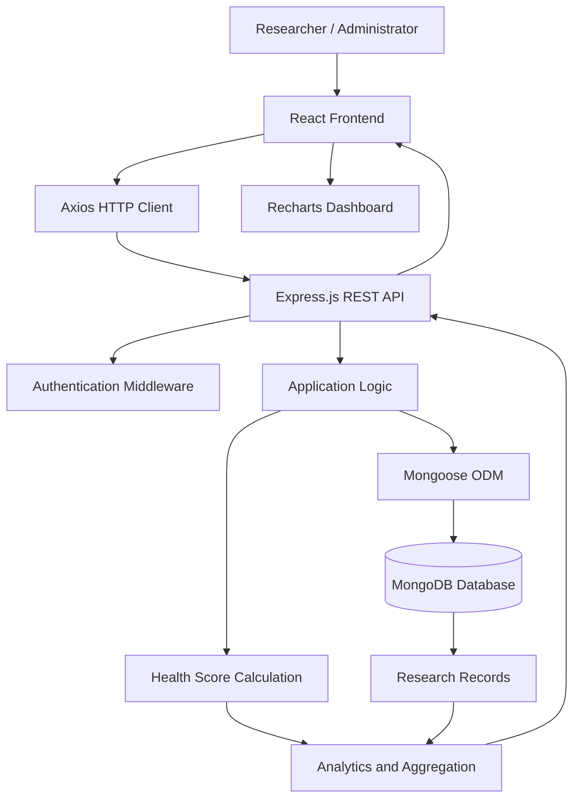

# 🧸 Pediatric Health Research System

### Exploring the Relationship Between Maternal Education and Child Health Outcomes

A full-stack healthcare research application designed to analyze and visualize pediatric health indicators through an interactive analytics dashboard. The system explores potential associations between maternal education and child health outcomes using vaccination, nutrition, hygiene, and illness-related indicators.

<p align="center">
  
  
  
  
  
</p>

<p align="center">
  <strong>Research · Analytics · Visualization · Healthcare Data</strong>
</p>

---

## 📌 Table of Contents

- [Overview](#-overview)
- [Project Objectives](#-project-objectives)
- [Key Features](#-key-features)
- [Technology Stack](#-technology-stack)
- [System Architecture](#-system-architecture)
- [Project Structure](#-project-structure)
- [Prerequisites](#-prerequisites)
- [Installation and Setup](#-installation-and-setup)
- [Application Workflow](#-application-workflow)
- [Health Score Calculation](#-health-score-calculation)
- [Security and Privacy](#-security-and-privacy)
- [Future Enhancements](#-future-enhancements)
- [Disclaimer](#-disclaimer)

---

## 🌟 Overview

The **Pediatric Health Research System** is a web-based application that provides a centralized platform for exploring pediatric health data and its potential relationship with maternal education.

By combining data management with interactive visualizations, the application helps users examine patterns across different health indicators and educational categories.

The system is built with a React-based frontend, a Node.js and Express backend, and MongoDB for data storage.

### 🎯 Project Objectives

- Investigate potential relationships between maternal education and child health outcomes.
- Visualize vaccination coverage and other pediatric health indicators.
- Examine nutrition, hygiene, and illness-related data.
- Calculate a consolidated health score using configured indicators.
- Provide a dashboard for exploring and managing research records.
- Support exploratory analysis through interactive charts and metrics.

---

## ✨ Key Features

| Feature | Description |
|---|---|
| 📊 Interactive Dashboard | Visualize research data through charts, graphs, and summary metrics. |
| 🎓 Maternal Education Analysis | Explore potential associations between education categories and child health indicators. |
| 💉 Vaccination Analysis | Examine vaccination records and coverage patterns. |
| 🥗 Nutrition Indicators | Explore nutrition-related information in the dataset. |
| 🧼 Hygiene Indicators | Include hygiene-related factors in health analysis. |
| 🩺 Illness Tracking | Examine recorded illness frequency and distribution. |
| 💯 Health Score | Calculate a score on a 0–100 scale using configured indicators. |
| 📝 Research Record Management | Add and manage pediatric research records through the interface. |
| 🔐 Authentication | Support token-based authentication and password hashing. |
| 📈 Data Visualization | Present research insights using interactive charts. |
| 🎨 Modern Interface | Provide a clean, medical-inspired user experience. |

*Feature availability depends on the implementation and API endpoints in the current version.*

---

## 🛠️ Technology Stack

### Frontend

| Technology | Purpose |
|---|---|
| React.js | User interface and reusable components |
| Vite | Development server and build tooling |
| Tailwind CSS | Interface styling |
| Recharts | Interactive data visualization |
| Axios | HTTP communication with the backend |
| React Router | Client-side navigation |
| Lucide React | Interface icons |

### Backend

| Technology | Purpose |
|---|---|
| Node.js | JavaScript runtime |
| Express.js | Backend server and REST API |
| MongoDB | Document-oriented database |
| Mongoose | MongoDB object modeling |
| JSON Web Token (JWT) | Token-based authentication |
| bcrypt.js | Password hashing |

---

## 🏗️ System Architecture

The application uses a client-server architecture to connect the user interface, backend API, and database.



### 🔄 Data Flow

1. The user interacts with the React frontend.
2. Axios sends requests to the backend API.
3. The Express server processes requests and applies authentication checks where configured.
4. Mongoose retrieves or updates data in MongoDB.
5. Application logic processes the available health indicators.
6. Analytics results are returned to the frontend.
7. The dashboard presents the data through charts and summary metrics.

---

## 📂 Project Structure

The project is expected to follow a structure similar to the one below. Adjust the names to match your actual repository.

```text
Pediatric-Health-Research-System/
│
├── frontend/
│   ├── public/
│   ├── src/
│   ├── package.json
│   └── vite.config.js
│
├── backend/
│   ├── models/
│   ├── routes/
│   ├── middleware/
│   ├── server.js
│   ├── seed.js
│   └── package.json
│
├── .gitignore
└── README.md
```

The presence and names of individual directories depend on the actual implementation.

---

## 📋 Prerequisites

Install the following before running the application locally.

| Requirement | Version / Configuration |
|---|---|
| Node.js | v18 or later |
| npm | Installed with Node.js |
| MongoDB | Local instance on port `27017` |
| Git | Recommended |
| Web browser | Any modern browser |

Verify Node.js and npm:

```bash
node --version
npm --version
```

Ensure MongoDB is running before starting the backend.

---

## 🚀 Installation and Setup

### 1. Clone the Repository

```bash
git clone https://github.com/kommareddydinesh/Pediatric-Health-Research-System.git

cd Pediatric-Health-Research-System
```

### 2. Configure the Backend

Open a terminal in the project directory:

```bash
cd backend
npm install
```

Configure the MongoDB connection and other required environment variables according to your backend configuration.

If your project uses a `.env` file, create one locally and use the variable names expected by your source code. Never commit actual secrets.

### 3. Seed Sample Research Data

If `seed.js` is included in your repository, run:

```bash
node seed.js
```

This script is intended to create an administrator account and populate sample pediatric research records, according to its implementation.

**Development credentials**

If the seed script retains its default credentials:

| Field | Value |
|---|---|
| Email | `admin@greennetspark.in` |
| Password | `Admin@123` |

These are development-only credentials. Verify the actual values in `seed.js`, and replace default credentials before deployment. Do not use them for a publicly accessible application.

### 4. Start the Backend Server

```bash
node server.js
```

Keep this terminal running.

Confirm that the server connects to MongoDB successfully and listens on the configured port.

### 5. Configure the Frontend

Open a second terminal from the project root:

```bash
cd frontend
npm install
npm run dev
```

Vite will display the frontend URL in the terminal. The default is usually:

http://localhost:5173

If your backend requires a frontend API URL, configure it using the environment variable expected by your application.

### 6. Launch the Application

1. Start MongoDB.
2. Start the backend server.
3. Start the frontend development server.
4. Open the displayed frontend URL.
5. Sign in using the credentials created by the seed script, if authentication is implemented.
6. Explore the dashboard and available research records.

---

## 📈 Application Workflow

The intended research workflow is:

**Access Dashboard → Explore Health Indicators → Analyze Patterns → Review Health Scores → Manage Records**

Users can explore the available dashboard metrics, examine vaccination and illness-related patterns, compare health indicators across maternal education categories, and review the results of configured health score calculations.

Actual workflows depend on the features implemented in the current application.

---

## 💯 Health Score Calculation

The application is designed to calculate a pediatric health score ranging from **0 to 100**, using configured indicators such as:

- Vaccination status
- Nutrition
- Hygiene
- Illness or disease history

A higher score represents a more favorable result according to the application's configured scoring rules.

**Research limitation:** The exact scoring formula, indicator weights, missing-data treatment, and interpretation must be verified in the source code. This score is an application-specific research metric, not a validated clinical assessment or diagnostic tool.

---

## 🔐 Security and Privacy

Security is particularly important when working with pediatric and health-related information.

Recommended practices:

- Store passwords using bcrypt hashing.
- Protect private API routes with authentication and authorization.
- Store database credentials, JWT secrets, and other sensitive configuration in environment variables.
- Add `.env` and other secret-bearing files to `.gitignore`.
- Commit a sanitized `.env.example` when configuration documentation is useful.
- Never publish real patient records or personally identifiable health information.
- Use synthetic or properly anonymized research data for demonstrations.
- Validate incoming API requests and configure appropriate CORS policies.
- Replace development credentials before deployment.
- Use HTTPS and appropriate access controls for deployed environments.

**Important:** A `.gitignore` file does not remove secrets that have already been committed. If an actual secret was exposed, rotate it and review the repository history.

---

## 🔮 Future Enhancements

Potential enhancements include:

- [ ] Advanced filtering by maternal education and health indicators.
- [ ] Exportable research reports in PDF and CSV formats.
- [ ] Date-based trends and comparative analytics.
- [ ] Role-based access control for researchers and administrators.
- [ ] Improved data validation and duplicate detection.
- [ ] Research dataset import and export.
- [ ] Statistical analysis with confidence intervals.
- [ ] Responsive design and accessibility improvements.
- [ ] Automated testing and continuous integration.
- [ ] Deployment with secure environment configuration.

---

## ⚕️ Disclaimer

This project is intended for **educational, research, and data-visualization purposes**.

Sample data should not be interpreted as actual patient information. The displayed scores and visualizations do not replace professional medical advice, clinical evaluation, or validated pediatric screening tools.

Observed relationships in research data do not establish causation. Any conclusions should be interpreted in the context of the dataset, study design, data quality, and appropriate statistical analysis.

---

## 👨‍💻 Author

**K. Dinesh Raj Pal Reddy**

GitHub: [@kommareddydinesh](https://github.com/kommareddydinesh)

Project: [Pediatric Health Research System](https://github.com/kommareddydinesh/Pediatric-Health-Research-System)

---

<p align="center">
  <strong>Built with React, Node.js, Express.js, and MongoDB.</strong>
  <br />
  Exploring pediatric health data through technology and research.
</p>

<p align="center">
  ⭐ If you find this project useful, consider starring the repository.
</p>
