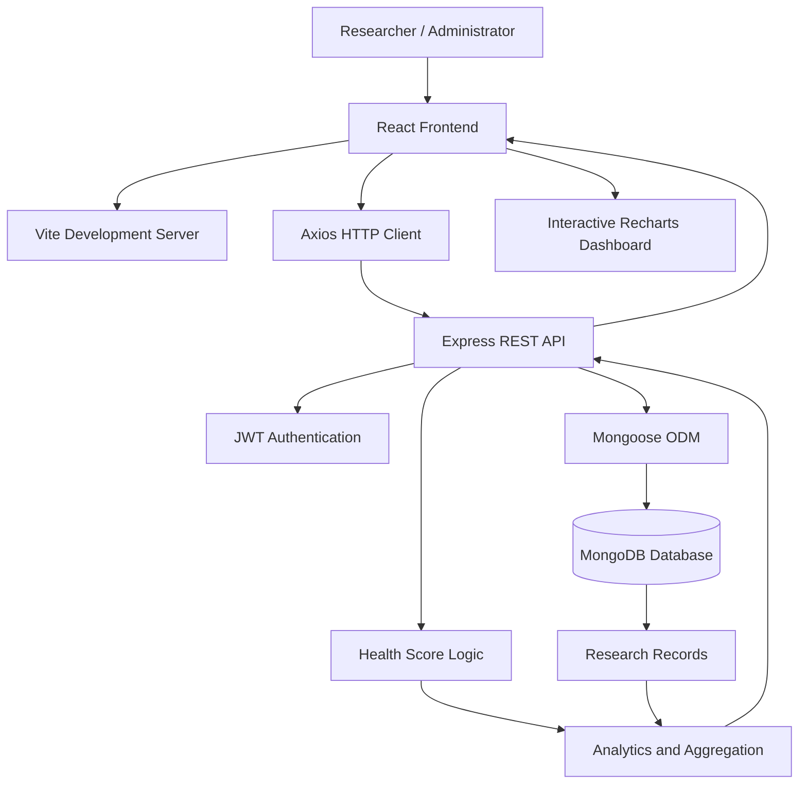

# 🧸 Pediatric Health Research System

### Understanding the Impact of Maternal Education on Child Health Outcomes

A full-stack health research application designed to analyze, visualize, and explore the relationship between **maternal education and pediatric health outcomes**. The platform provides interactive analytics, health score calculations, and research insights through a modern, medical-inspired dashboard.

\<p align="center">
&#x20; \
&#x20; \
&#x20; \
&#x20; \
\</p>

---

## 📑 Table of Contents

- [Overview](#-overview)
- [Key Features](#-key-features)
- [Technology Stack](#-technology-stack)
- [System Architecture](#-system-architecture)
- [Prerequisites](#-prerequisites)
- [Installation and Setup](#-installation-and-setup)
- [Usage Guide](#-usage-guide)
- [Health Score Calculation](#-health-score-calculation)
- [Security Considerations](#-security-considerations)
- [Future Enhancements](#-future-enhancements)
- [Disclaimer](#-disclaimer)

---

## 🌟 Overview

The **Pediatric Health Research System** is a web-based research platform developed to support the exploration of pediatric health indicators and their potential relationship with maternal education.

The application brings together child health records, vaccination information, nutrition indicators, hygiene factors, and illness tracking in one centralized interface.

Through interactive charts and analytical dashboards, researchers can explore patterns in the available dataset and better understand potential associations between maternal education and child health outcomes.

### 🎯 Project Objectives

- Analyze the relationship between maternal education and child health indicators.
- Visualize vaccination coverage, nutrition, hygiene, and illness frequency.
- Calculate a consolidated pediatric health score.
- Provide a centralized interface for managing research records.
- Generate interactive insights to support exploratory health research.

---

## ✨ Key Features

| Feature                        | Description                                                                         |
| ------------------------------ | ----------------------------------------------------------------------------------- |
| 📊 Interactive Analytics       | Visualize pediatric health indicators through interactive charts and graphs.        |
| 🎓 Maternal Education Analysis | Explore potential relationships between education levels and child health outcomes. |
| 💉 Vaccination Tracking        | Analyze vaccination information and coverage in the research dataset.               |
| 🥗 Nutrition Monitoring        | Examine nutrition-related indicators recorded for pediatric research.               |
| 🧼 Hygiene Assessment          | Include hygiene indicators in the overall health assessment.                        |
| 🩺 Illness Tracking            | Explore recorded illness frequency and related health patterns.                     |
| 💯 Health Score Calculation    | Generate a score on a 0–100 scale using configured health indicators.               |
| 📝 Record Management           | Add pediatric research records and refresh dashboard insights.                      |
| 🔐 Authentication              | Support authenticated access using JSON Web Tokens and password hashing.            |
| 🎨 Modern User Interface       | Deliver a clean, responsive interface with a medical-inspired visual design.        |

---

## 🛠️ Technology Stack

### Frontend

- **React.js** — Component-based user interface
- **Vite** — Development server and build tooling
- **Tailwind CSS** — Utility-first styling
- **Recharts** — Data visualization and analytics
- **Axios** — HTTP requests to the backend API
- **React Router** — Client-side navigation
- **Lucide React** — Consistent interface icons

### Backend

- **Node.js** — JavaScript runtime
- **Express.js** — REST API and server-side routing
- **MongoDB** — Document-oriented database
- **Mongoose** — MongoDB object modeling
- **JSON Web Token (JWT)** — Token-based authentication
- **bcrypt.js** — Password hashing

---

## 🏗️ System Architecture

The application follows a client-server architecture with a React frontend, an Express backend, and MongoDB for data persistence.



### Data Flow

1. The researcher interacts with the React interface.
2. Axios sends requests to the Express backend.
3. The backend processes requests and validates authentication where required.
4. Mongoose communicates with MongoDB to retrieve or update research records.
5. Health score logic and analytics process the available data.
6. The frontend displays the resulting information through charts, metrics, and dashboard components.

---

## 📋 Prerequisites

Ensure the following software is installed before running the application.

| Requirement | Version / Configuration                |
| ----------- | -------------------------------------- |
| Node.js     | v18 or later                           |
| npm         | Included with Node.js                  |
| MongoDB     | Local instance running on port `27017` |
| Web browser | Any modern browser                     |
| Git         | Recommended for version control        |

Verify your installations:

```bash
node --version
npm --version
```

Verify that MongoDB is running before starting the backend.

---

## 🚀 Installation and Setup

Follow these steps to run the application locally.

### 1. Clone the Repository

If the project is hosted on GitHub, clone it and navigate to its directory.

```bash
git clone <YOUR_REPOSITORY_URL>
cd <YOUR_PROJECT_FOLDER>
```

Replace the placeholders with your actual repository URL and project folder name.

### 2. Configure the Backend

Open a terminal in the project root and navigate to the backend directory.

```bash
cd backend
npm install
```

#### Seed the Research Dataset

Run the seed script to create an administrator account and populate sample pediatric research records.

```bash
node seed.js
```

**Development seed credentials**

| Field    | Value                    |
| -------- | ------------------------ |
| Email    | `admin@greennetspark.in` |
| Password | `Admin@123`              |

These credentials are intended for local development only. Change them before any deployment, and never use seeded sample records as real clinical data.

#### Start the Backend Server

```bash
node server.js
```

Keep this terminal open while using the application.

> **Note:** The backend port and database connection settings depend on your `server.js` and configuration files. Ensure they match your local environment.

### 3. Configure the Frontend

Open a second terminal from the project root.

```bash
cd frontend
npm install
npm run dev
```

Vite will display the local development URL in the terminal. It is typically:

**[http://localhost:5173](http://localhost:5173)**

### 4. Launch the Application

1. Confirm that MongoDB is running.
2. Start the backend server.
3. Start the frontend development server.
4. Open the displayed frontend URL in your browser.
5. Sign in using the development credentials created by `seed.js`.
6. Explore the dashboard and available research records.

---

## 📈 Usage Guide

Once the application is running, you can use the available features to explore the sample research dataset.

### Research Workflow

- **Access the dashboard:** Review the available pediatric health indicators.
- **Explore education patterns:** Compare maternal education categories with recorded child health outcomes.
- **Review vaccinations:** Examine vaccination information and coverage.
- **Analyze illness frequency:** Explore the distribution of recorded illnesses.
- **Inspect health scores:** Review calculated scores and their contributing indicators.
- **Add research records:** Enter new records using the application's available forms.
- **Review updated insights:** Check the dashboard for refreshed results after data changes.

> Available functionality depends on the components and API endpoints implemented in your current version.

---

## 💯 Health Score Calculation

The system is designed to calculate a pediatric health score on a scale of **0 to 100**, using configured indicators such as:

- Vaccination status
- Nutrition indicators
- Hygiene indicators
- Illness or disease history

A higher score represents a more favorable result under the application's configured scoring rules.

**Important:** The exact formula, indicator weights, missing-data handling, and score interpretation must be verified against the implementation in your source code. This score is a research metric and should not be treated as a validated clinical assessment or a diagnosis.

---

## 🔐 Security Considerations

Because this application handles pediatric and health-related information, security and privacy should be treated as core requirements.

- Store passwords using bcrypt hashing rather than plaintext.
- Protect private API routes with appropriate authentication and authorization checks.
- Store secrets and database credentials in environment variables.
- Add a `.env` file to `.gitignore` and commit only a safe `.env.example`.
- Replace development credentials before deployment.
- Configure appropriate CORS policies and validate incoming API data.
- Avoid exposing identifiable pediatric information in logs or public dashboards.
- Use anonymized or synthetic records for demonstrations and testing.
- Apply appropriate access controls, backups, and data-retention practices before using real research data.

Never publish real children's health information or production credentials in a public repository.

---

## 🔮 Future Enhancements

Potential improvements for future versions include:

- [ ] Advanced filtering by maternal education level and health indicator.
- [ ] Exportable research reports in PDF and CSV formats.
- [ ] Date-based trends and comparative analytics.
- [ ] Improved role-based access control for researchers and administrators.
- [ ] Data validation and duplicate-record detection.
- [ ] Research dataset import and export.
- [ ] Statistical analysis and confidence intervals for group comparisons.
- [ ] Accessibility improvements and enhanced mobile responsiveness.
- [ ] Automated testing and deployment workflows.

---

## ⚕️ Disclaimer

This project is intended for **educational, research, and data-visualization purposes**. Any sample data generated by the seeding script is synthetic and must not be interpreted as actual patient information.

The displayed health scores and analytics are not substitutes for professional medical advice, clinical evaluation, or validated pediatric screening tools. Associations observed in research data do not establish causation.

---

## 👨‍💻 Development

Contributions and improvements are welcome. Before submitting changes, test the frontend and backend locally and ensure that no sensitive information or credentials are included.

**Built with React, Node.js, MongoDB, and a focus on pediatric health research.**

⭐ If you find this project useful, consider giving the repository a star on GitHub.
